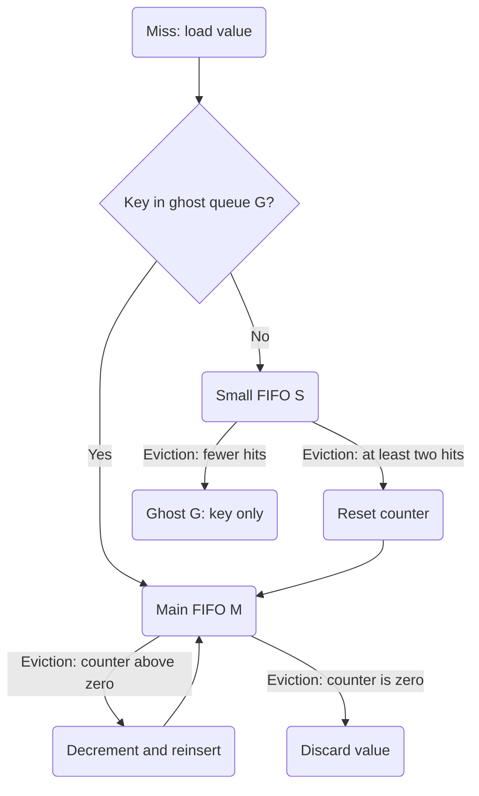

A cache is easy to fill. The interesting part starts when it runs out of room.

Imagine caching product details. Some products are requested all day, others become popular for an hour, and a crawler occasionally walks through the entire catalog. Which entry should leave when the next one arrives?

LRU remembers recency. LFU remembers frequency. S3-FIFO gives new entries a short trial and keeps stronger reuse evidence separately. These are three different guesses about future requests.

I use these policies in [Velis](/portfolio/velis). Here, small Python versions make the decisions visible without the networking, expiration, or byte accounting of a cache server.

## One interface for all three

Each example exposes `cache.get(key, load)`. On a hit it returns the cached value. On a miss it calls `load(key)`, makes room, and stores the result. Values can be `None`: membership, rather than a special return value, distinguishes hits from misses.

Capacity counts resident entries, assuming equal-size objects. The examples are synchronous and have no expiration or concurrency control. A failed load does not evict an existing value. Paste the Python blocks into one file to run the comparison at the end.

## LRU: keep what was used recently

Least Recently Used keeps entries ordered by their last access. A hit moves an entry to the newest end; eviction removes the oldest.

With capacity three, the requests `A B C A D` produce this sequence:

| Request | Oldest → newest | Result        |
| ------- | --------------- | ------------- |
| A       | A               | Miss          |
| B       | A B             | Miss          |
| C       | A B C           | Miss          |
| A       | B C A           | Hit           |
| D       | C A D           | Miss; evict B |

Python's [`OrderedDict`](https://docs.python.org/3/library/collections.html#collections.OrderedDict) supplies both reordering and removal from the oldest end.

```python
from collections import OrderedDict


class LRU:
    def __init__(self, capacity):
        if capacity < 1:
            raise ValueError("capacity must be positive")
        self.capacity = capacity
        self.data = OrderedDict()

    def get(self, key, load):
        if key in self.data:
            self.data.move_to_end(key)
            return self.data[key]

        value = load(key)
        if len(self.data) == self.capacity:
            self.data.popitem(last=False)
        self.data[key] = value
        return value
```

This is a useful baseline when recent use predicts another request soon. But a scan of distinct keys can replace the entire cache, even if those keys are never requested again. Keeping exact recency also means updating shared ordering on hits.

## LFU: keep what was used often

Least Frequently Used evicts the entry with the smallest access count. This version breaks frequency ties by evicting the least recently accessed entry.

Each record stores a value, a count, and a logical timestamp. The initial request counts as one access; later hits increase it.

```python
class LFU:
    def __init__(self, capacity):
        if capacity < 1:
            raise ValueError("capacity must be positive")
        self.capacity = capacity
        self.clock = 0
        self.data = {}

    def get(self, key, load):
        self.clock += 1
        if key in self.data:
            value, count, _ = self.data[key]
            self.data[key] = (value, count + 1, self.clock)
            return value

        value = load(key)
        if len(self.data) == self.capacity:
            victim = min(
                self.data,
                key=lambda item: self.data[item][1:],
            )
            del self.data[victim]
        self.data[key] = (value, 1, self.clock)
        return value
```

The `min` call makes this version's eviction O(n). That keeps the policy easy to read; it is not a limit of LFU itself. Frequency buckets can support [O(1) operations](https://arxiv.org/abs/2110.11602), with more bookkeeping.

LFU can protect popular entries through a scan, but an old favorite can accumulate enough credit to stay long after demand changes. These counters reset only when an entry is evicted. Practical policies often age popularity: [Redis's approximate LFU](https://redis.io/docs/latest/reference/eviction/) combines probabilistic counters with decay. The example deliberately leaves that out so the stale-popularity problem is visible.

## S3-FIFO: give new entries a trial

[S3-FIFO](https://s3fifo.com/) uses a small FIFO queue **S**, a main FIFO queue **M**, and a ghost queue **G**. G remembers keys, not cached values. Finding a key there is still a cache miss, but the returning entry goes directly into M.

Hits increase a counter capped at three without changing queue order. At eviction, an S entry with at least two hits since insertion moves to M with its counter reset. Other S entries leave their keys in G. In M, a positive counter earns reinsertion at the newest end and is decremented; zero means eviction. These rules follow the [original paper's design](https://juncheng.seas.harvard.edu/publication/sosp23-s3fifo.pdf).



Here is a compact version with a small-queue target of 10%, with a minimum of one slot. S and M share the resident budget while filling; G is bounded separately to the remaining 90% target. It requires capacity of at least two. Lists hold `[value, counter]` pairs; each ordered dictionary acts as a FIFO. Ghost history costs extra memory even though it holds no values.

```python
class S3FIFO:
    def __init__(self, capacity):
        if capacity < 2:
            raise ValueError("S3FIFO needs capacity >= 2")
        self.capacity = capacity
        self.small_target = max(1, capacity // 10)
        self.main_target = capacity - self.small_target
        self.small = OrderedDict()
        self.main = OrderedDict()
        self.ghost = OrderedDict()

    def get(self, key, load):
        for queue in (self.small, self.main):
            if key in queue:
                entry = queue[key]
                entry[1] = min(3, entry[1] + 1)
                return entry[0]

        value = load(key)
        returning = key in self.ghost
        self.ghost.pop(key, None)
        self._make_room()
        queue = self.main if returning else self.small
        queue[key] = [value, 0]
        return value

    def _make_room(self):
        while len(self.small) + len(self.main) >= self.capacity:
            if self.small and (
                len(self.small) >= self.small_target or not self.main
            ):
                key, entry = self.small.popitem(last=False)
                if entry[1] >= 2:
                    entry[1] = 0
                    self.main[key] = entry
                    if len(self.main) > self.main_target:
                        self._evict_main()
                else:
                    self.ghost[key] = None
                    if len(self.ghost) > self.main_target:
                        self.ghost.popitem(last=False)
            else:
                self._evict_main()

    def _evict_main(self):
        while self.main:
            key, entry = self.main.popitem(last=False)
            if entry[1] == 0:
                return
            entry[1] -= 1
            self.main[key] = entry
```

The main distinction from LRU is where work happens: hits update a small counter, and eviction does queue movement. One eviction can examine several entries, so this implementation does not promise constant worst-case insertion time. Python dictionaries and lists also have very different memory costs from the paper's systems implementation.

The [reference implementation](https://github.com/1a1a11a/libCacheSim/blob/develop/libCacheSim/cache/eviction/S3FIFO.c) is worth reading for a fuller implementation and its queue-allocation choices. A workload whose second requests arrive after S has already discarded their values can still favor LRU; a ghost record cannot serve a value.

## Run the same requests through each cache

Counting loader calls gives an exact miss count for these examples. The loader returns the key itself so the experiment measures eviction decisions, without backend latency or timing noise.

```python
def replay(policy, requests, capacity=10):
    cache = policy(capacity)
    misses = 0

    def load(key):
        nonlocal misses
        misses += 1
        return key

    for key in requests:
        assert cache.get(key, load) == key
    return len(requests) - misses, misses


traces = {
    "steady": list(range(8)) * 40,
    "scan": list(range(4)) * 20
        + list(range(100, 200))
        + list(range(4)) * 20,
    "shift": list(range(8)) * 20 + list(range(8, 16)) * 20,
}

for name, requests in traces.items():
    print(name)
    for policy in (LRU, LFU, S3FIFO):
        hits, misses = replay(policy, requests)
        print(f"  {policy.__name__:6} hits={hits:3} misses={misses:3}")
```

Running this file produces:

| Trace (capacity 10) | LRU hits / misses | LFU hits / misses | S3-FIFO hits / misses |
| ------------------- | ----------------: | ----------------: | --------------------: |
| steady              |           312 / 8 |           312 / 8 |               312 / 8 |
| scan                |         152 / 108 |         156 / 104 |             156 / 104 |
| shift               |          304 / 16 |         152 / 168 |              296 / 24 |

The steady trace has only the eight initial misses. During the scan, LFU and S3-FIFO keep the four hot entries, saving four reloads when they return. After the popularity shift, LFU keeps old high-count entries and repeatedly misses on the new set; S3-FIFO relearns it with eight more misses than LRU.

These are deliberately small, synthetic traces. They explain decisions rather than establish a winner for a real service. The scan revisits the hot set only after the scan finishes; interleaving hot requests would change the result. The shift keeps both phases' access patterns identical but changes their keys, exposing the cost of retaining old frequency counts.

## What I would measure before choosing

| Policy  | Evidence retained                       | Hit-path work here         | Eviction work here           | Main weakness to test                |
| ------- | --------------------------------------- | -------------------------- | ---------------------------- | ------------------------------------ |
| LRU     | Last-access ordering                    | Move entry to newest end   | Remove oldest entry          | Scans displacing useful data         |
| LFU     | Resident access counts and recency ties | Update count and timestamp | Scan for minimum: O(n)       | Popularity changing over time        |
| S3-FIFO | Bounded reuse counters and ghost keys   | Increment capped counter   | Promote, reinsert, or remove | Reuse arriving after the short trial |

I would start with LRU as a baseline, then replay actual requests at several cache sizes. For a stable popular set, I would test LFU with an explicit aging policy. For lots of entries that are fetched once and disappear, I would include S3-FIFO.

Hit rate is one part of that comparison. Entry sizes, metadata memory, backend miss cost, eviction latency, and contention all affect the service. A cache full of large, cheap-to-reload objects can have a good object hit rate while delivering poor value per byte. Expiration and invalidation also need separate rules: an eviction policy chooses what leaves under pressure, not whether a value is still valid.

For Python application code, [`functools.lru_cache`](https://docs.python.org/3/library/functools.html#functools.lru_cache) is a useful starting point for bounded function memoization. The implementations above are small enough to inspect and alter; they are a way to understand the tradeoffs before choosing a library or building a cache server.
